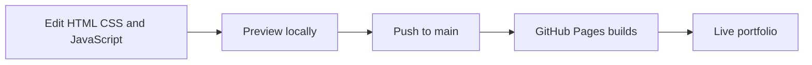
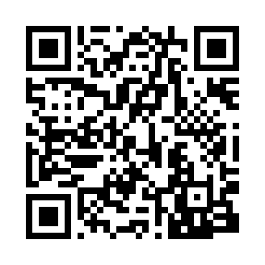

# Manasa Rajagopal Madabushi

A responsive portfolio of my work in software engineering, AI, machine learning, and data analytics.

**[View live portfolio](https://manasa123104.github.io/Manasa-portfolio/)** · [LinkedIn](https://www.linkedin.com/in/manasa-rajagopal-madabushi-4217461b3) · [Email](mailto:manasamadabushi@gmail.com)

## Explore

Projects, professional experience, education, certifications, resume, and photography.

**Featured:** [Mind & Body Wellness Tracker](https://stillwell-wellness-space.naturalbracelet.chatgpt.site/) — encrypted device accounts, wellbeing logs, activity tracking, and Word/Excel exports.

## Workflow

**Stack:** HTML · CSS · JavaScript · Font Awesome

**Preview:** Open `index.html` locally. No installation or build step required.

## Scan to visit

[Open the portfolio](https://manasa123104.github.io/Manasa-portfolio/) if you cannot scan the code.
